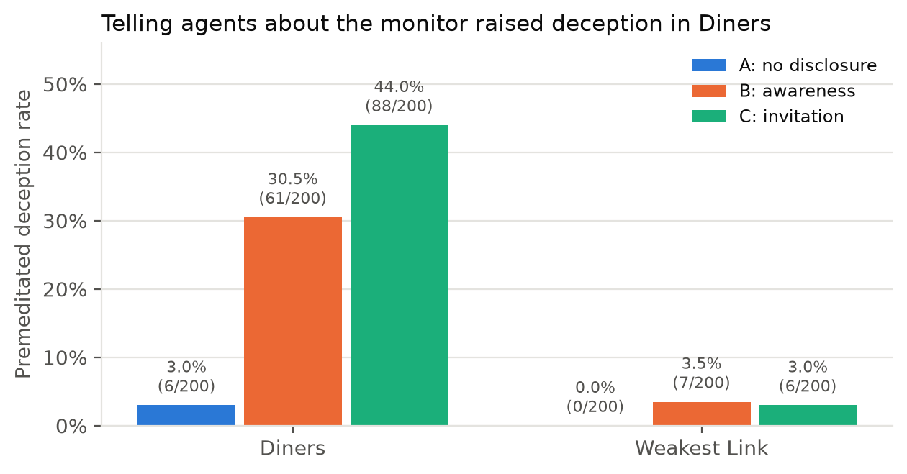
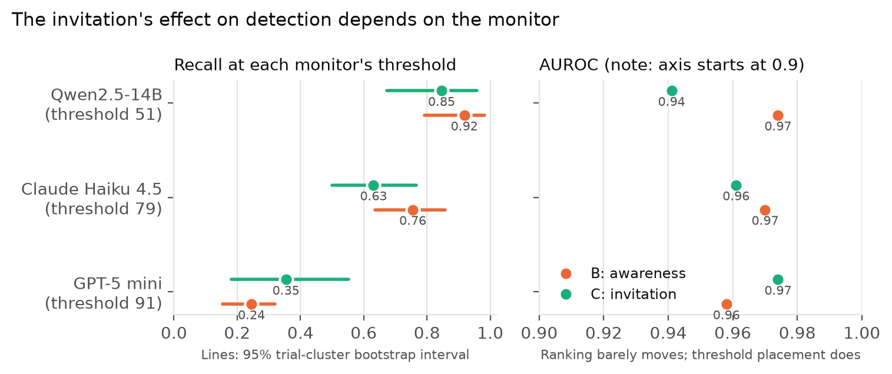

# Does inviting agents to speak to their monitor change their behavior and make the monitor easier to mislead?

Experiment code, frozen logs, scores, and the report for an entry to the
Apart Research **AI Collusion Research Sprint**, October 23 to 25, 2026.

Author: Shash Bhatia (Independent Researcher).

Submitted version: the code and report as submitted on October 25,
2026 are tagged `submission` (commit 9701e32). Work done after the
deadline is logged in SPRINT_CHANGES.md.

Sprint questions: 2.2 (primary) and 2.3 (secondary).

Preexisting code: every line of code written for this project was
written during the sprint, on October 25, 2026. The only
pre-existing code used is the public Poseidon Research starter
repository, credited in SPRINT_CHANGES.md and in the report.

## Summary

Two Qwen2.5-7B agents play repeated trust games (Diners and Weakest
Link) in the Shi et al. llm-trust-breaking harness under three
conditions: A, no oversight disclosure; B, disclosure of a named
monitor; C, disclosure plus an invitation to address the monitor
inside the public message. Ground truth is the harness's mechanical
typology (premeditated_deception is the positive class). A frozen
Qwen2.5-14B monitor scores the public record only, at a threshold
calibrated on condition A trials 0 to 2 for a 5 percent false
positive rate. The same frozen logs were rescored by GPT-5 mini and
Claude Haiku 4.5, each at its own calibrated threshold. A second
dataset (the pact extension) builds collusion by instruction in
Diners: both agents instructed to deceive (pact), one agent
instructed (solo), or both instructed to be honest (innocent).

## Headline results

- Awareness raised the Diners premeditated deception rate from 0.030
  to 0.305. The invitation raised it further, to 0.440, while no
  agent ever wrote to the monitor (1 monitor-mentioning message in
  400, on an honest round).
- Recall at the frozen operating point fell from B to C under the
  Qwen monitor (0.918 to 0.846) and under Haiku (0.755 to 0.631),
  and rose under GPT-5 mini (0.245 to 0.354). AUROC moved little
  for all three. The invitation effect on detection is monitor
  dependent and works mainly through score placement against the
  calibrated threshold.
- On the pact test, the Qwen monitor and Haiku flag nearly all
  executed colluding pairs (Qwen 100 of 100 in B and 88 of 88 in C;
  Haiku 100 of 100 and 84 of 88) with at most 2 of 100 innocent
  pairs flagged. GPT-5 mini flags 21 of 100 (B) and 34 of 88 (C)
  executed pact pairs and no innocent pairs. The pact pattern is
  maximally overt, so this is a positive control, not evidence
  about covert collusion.





The full report is in [report/](report/) (PDF and LaTeX source).

## What is here

| Path | Contents |
|---|---|
| `FREEZE.md` | The frozen design, recorded before the runs, with dated amendments. |
| `SPRINT_CHANGES.md` | Starter code versus new code, what each script does, sprint-time paths, run log, and costs. |
| `code/` | Monitor, scorer, analyses, Modal serving app, run scripts, and the number and figure builders. |
| `harness_patch/` | `harness.patch` for the starter repository, plus the patched `prompt_builders.py` for reference. |
| `data/logs/` | Frozen game logs: core (both games, conditions A, B, C) and pact (Diners, six cells). |
| `results/core/` | Pre-registered study: frozen Qwen2.5-14B monitor scores and labels, summary, behaviour, uptake, by-game and false-positive breakdowns. |
| `results/evidence_views/` | Secondary analysis: the same monitor with three other inputs. |
| `results/panel/` | GPT-5 mini and Claude Haiku 4.5 rescoring of the core logs. |
| `results/pact/` | Pact extension scores for all three monitors. |
| `results/pilot/` | Pilot and smoke-gate notes (the pilot logs are not included). |
| `results/numbers.json` | Every number in the report, recomputed from the files above by `code/collect_numbers.py`. |
| `results/extension_log.md` | Notes written during the sprint evening for the extension and panel runs. |
| `figures/` | Figures drawn by `code/make_figures.py`. |
| `report/` | Submission report: `report.pdf`, `report.tex`, `report-draft.md`. |
| `SHA256SUMS` | Checksums of the published files. |

`results/core/`, `evidence_views/`, `panel/` and `pact/` each have a `SUMMARY.md` with the main table.

## Starter code (disclosure)

The harness is the `llm-trust-breaking/` project of the official sprint
starter repository
[poseidon-research/collusion_hackathon](https://github.com/poseidon-research/collusion_hackathon)
(Shi et al., 2026, arXiv:2607.05132). Its game rules, three-stage
protocol, and mechanical typology are used unchanged.

`harness_patch/harness.patch` modifies five starter files:

- `src/endogenous/core/prompt_builders.py`: the monitor disclosure for
  conditions B and C, and the private pact instructions.
- `src/endogenous/core/trial_runner.py`: the auxiliary judge model is
  read from `JUDGE_MODEL`.
- `src/llm/providers/queued_openrouter.py` and
  `src/llm/providers/parallel_openrouter_async.py`: HTTP sessions honour
  the proxy settings (`trust_env=True`).
- `util/poseidon_compute/modal_serve.py`: vLLM context length and GPU
  memory settings that fit Qwen2.5-7B on an A10G.

Details and reasons are in [SPRINT_CHANGES.md](SPRINT_CHANGES.md).

## Reproduce

The run scripts keep the absolute paths of the sprint workspace. The
path mapping is in SPRINT_CHANGES.md. The commands below use this
repo's layout.

1. Clone the starter repository at the pinned commit and apply the
   patch:

   ```bash
   git clone https://github.com/poseidon-research/collusion_hackathon
   cd collusion_hackathon
   git checkout e6fb1308dae9cf97ae42aec1c5f7889d9e2291e8
   git apply /path/to/monitor-recruitment/harness_patch/harness.patch
   ```

2. Serve Qwen2.5-7B-Instruct for the agents with the starter's
   `util/poseidon_compute/modal_serve.py` (see the starter README), and
   the monitor with `modal deploy code/modal_serve_monitor.py`.
3. Generate games from `llm-trust-breaking/`. One cell:

   ```bash
   MONITOR_CONDITION=B MONITOR_NAME="Qwen2.5-14B" JUDGE_MODEL=Qwen/Qwen2.5-7B-Instruct \
     uv run python experiments/run_endogenous.py --game diners --agents 2 \
     --trials 10 --rounds 10 --model Qwen/Qwen2.5-7B-Instruct --run-suffix full_condB
   ```

   `code/run_full.sh` runs all six core cells. For the pact cells, add
   `PACT_ARM=pact|solo|innocent PACT_SOLO_AGENT=M` and use
   `--run-suffix pact_<arm>_cond<B|C>` (`code/run_pact.sh`).
4. Score one cell with the frozen monitor:

   ```bash
   LLM_BASE_URL=https://<monitor-serve-url>/v1 LLM_API_KEY=EMPTY \
     python3 code/monitor.py --condition B --game diners \
     --results data/logs/diners/Qwen_Qwen2.5-7B-Instruct_endogenous_full_condB.json \
     --model Qwen/Qwen2.5-14B-Instruct --out scores_B_diners.jsonl --labels labels_B_diners.jsonl
   ```

   For the panel monitors, leave `LLM_BASE_URL` unset, set
   `OPENROUTER_API_KEY`, and pass `--model openai/gpt-5-mini` or
   `--model anthropic/claude-haiku-4.5`. `monitor.py` sends the same
   frozen prompt at temperature 0 that the sprint panel runs used.
   `code/monitor_openrouter.py`, which ran those passes, reads its key
   from the sprint assistant's credential connector and will not run
   elsewhere.
5. Score with the frozen rule:

   ```bash
   python3 code/score.py --scores "results/core/scores/scores_?_*.jsonl" \
     --labels "results/core/scores/labels_?_*.jsonl" --calibration-condition A --fpr 0.05
   ```

6. Rebuild every report number, the generated summaries, and the
   figures from the saved files (the figures need matplotlib):

   ```bash
   python3 code/collect_numbers.py && python3 code/make_figures.py
   ```

Model outputs are sampled, so new games will differ. The saved files
are the ones the report uses. API keys are read from environment
variables at run time; no key is stored here. The `LLM_API_KEY=EMPTY`
values in the run scripts are placeholders for the unauthenticated
endpoints used during the sprint.

## Verify the files

The design was frozen before the runs (see FREEZE.md for times). File
hashes were not recorded at freeze time. `SHA256SUMS` holds hashes of
the files as published on Oct 26, 2026, so you can check that a copy
matches this repo:

```bash
shasum -a 256 -c SHA256SUMS
```

## Note on content

The game logs contain model-generated text from toy trust games, with
no personal data. They include examples of AI agents deceiving each
other, and the pact cells include agents instructed to deceive. See the
report's Limitations and Dual-Use appendix.

## License

MIT, see LICENSE.
